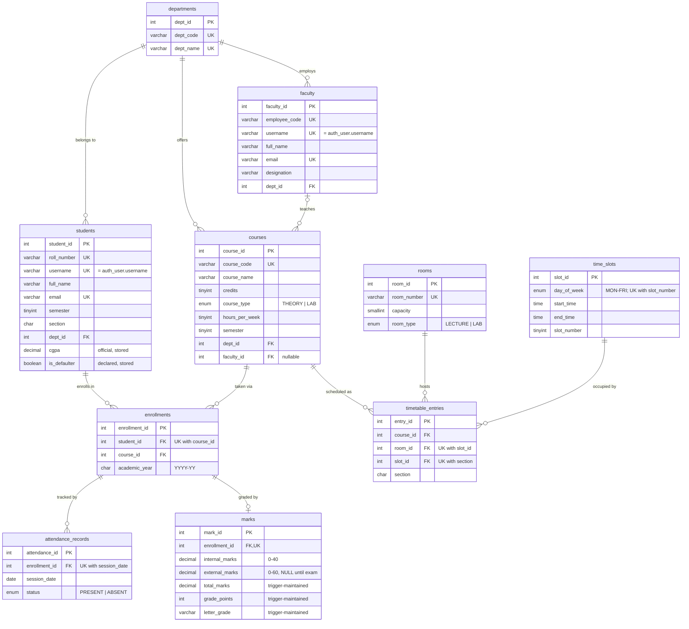

# Database Design: `smart_campus_db`

This is the DBMS Lab design reference. It must match [`database/schema.sql`](../database/schema.sql) and [`database/views_triggers.sql`](../database/views_triggers.sql); update both in the same commit.

## ER diagram

## Functional dependencies and normal form

Every table has a single-column surrogate key. The candidate keys are listed so the 3NF argument is explicit: every non-key attribute depends on the whole key and on nothing but the key.

| Table | Candidate keys | Functional dependencies |
|---|---|---|
| `departments` | `dept_id`, `dept_code`, `dept_name` | `dept_id → dept_code, dept_name` |
| `rooms` | `room_id`, `room_number` | `room_id → room_number, capacity, room_type` |
| `time_slots` | `slot_id`, `(day_of_week, slot_number)`, `(day_of_week, start_time)` | `slot_id → day_of_week, start_time, end_time, slot_number` |
| `faculty` | `faculty_id`, `employee_code`, `username`, `email` | `faculty_id → employee_code, username, full_name, email, designation, dept_id` |
| `students` | `student_id`, `roll_number`, `username`, `email` | `student_id → roll_number, username, full_name, email, semester, section, dept_id, cgpa, is_defaulter` |
| `courses` | `course_id`, `course_code` | `course_id → course_code, course_name, credits, course_type, hours_per_week, semester, dept_id, faculty_id` |
| `enrollments` | `enrollment_id`, `(student_id, course_id)` | `enrollment_id → student_id, course_id, academic_year` |
| `attendance_records` | `attendance_id`, `(enrollment_id, session_date)` | `attendance_id → enrollment_id, session_date, status` |
| `marks` | `mark_id`, `enrollment_id` | `mark_id → enrollment_id, internal_marks, external_marks`; `internal_marks, external_marks → total_marks → grade_points → letter_grade` (see below) |
| `timetable_entries` | `entry_id`, `(room_id, slot_id)`, `(slot_id, section)` | `entry_id → course_id, room_id, slot_id, section` |

How the design avoids the usual 3NF violations:
- **Department names** are stored only in `departments`. Everyone else stores `dept_id`.
- **Faculty and course details** live in their own tables. Attendance and marks reference an `enrollment_id` only.
- **Course to faculty** is recorded once, on `courses`. The timetable reaches the teacher through `course_id`.

### Deliberately stored derived columns

`CLAUDE.md` says derived values belong in views unless there is a documented reason to store them. These are the exceptions and the reasons for each:

| Column | Why it is stored | Kept correct by |
|---|---|---|
| `marks.total_marks`, `grade_points`, `letter_grade` | Grade reports, the Java engine and Django read the grade directly, and it must look identical in all three. This is a transitive dependency on the marks, so it is never written by hand. | `trg_marks_before_insert` / `trg_marks_before_update`, using `fn_grade_points` and `fn_letter_grade`. Client-supplied values are overwritten. |
| `students.cgpa` | The official cumulative GPA includes semesters 1-2, which are not in this database, so it cannot be derived here. | It is entered by the admin. `v_student_cgpa_report` shows it next to the GPA computed from current marks. |
| `students.is_defaulter` | The *declared* detention status at the attendance cut-off. It is a decision, not a live figure. | `sp_refresh_defaulter_flags()`. `v_defaulter_list` is the always-current computation. |

## Business rules and where they are enforced

| Rule | Enforcement |
|---|---|
| Total = internal (0-40) + external (0-60); the grading scale is 10/O ≥ 90, 9/A+ ≥ 80, 8/A ≥ 70, 7/B+ ≥ 60, 6/B ≥ 50, 5/P ≥ 40, 0/F | `chk_marks_*` and the marks triggers |
| A faculty member teaches at most one class per time slot | `trg_prevent_timetable_faculty_clash` (INSERT) and `trg_prevent_timetable_faculty_clash_update` (UPDATE) |
| A room hosts one class per slot; a section attends one class per slot | `uq_timetable_entries_room_slot`, `uq_timetable_entries_slot_section` |
| A student enrolls in a course at most once; a mark exists at most once per enrollment; attendance is recorded once per enrollment per day | `uq_enrollments_student_course`, `uq_marks_enrollment`, `uq_attendance_records_enrollment_date` |
| Classes (and attendance) run Monday to Friday | `day_of_week` ENUM, `chk_attendance_records_weekday` |
| A username belongs to exactly one person across `students` and `faculty` | per-table UNIQUE plus `trg_students_before_*` / `trg_faculty_before_*` |
| Attendance below 75% makes a student a defaulter | `v_defaulter_list`, declared by `sp_refresh_defaulter_flags()` |
| Deleting a student removes their enrollments, attendance and marks; a course with enrollments cannot be deleted | FK `ON DELETE CASCADE` / `RESTRICT` |

### Known limitations

- **Sections are single letters with no department or semester qualifier.** `UNIQUE (slot_id, section)` therefore means two different semesters or departments cannot both have a section "A" class in the same slot. That is fine for the current single-batch data. Before adding a second batch, qualify the section, for example with a `sections` table.
- **`UNIQUE (student_id, course_id)` on `enrollments`** means a student cannot re-register for a course they failed in a later academic year.
- **One attendance record per enrollment per day,** so two sessions of the same course on one day cannot both be recorded.
