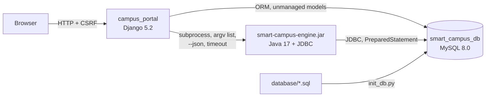
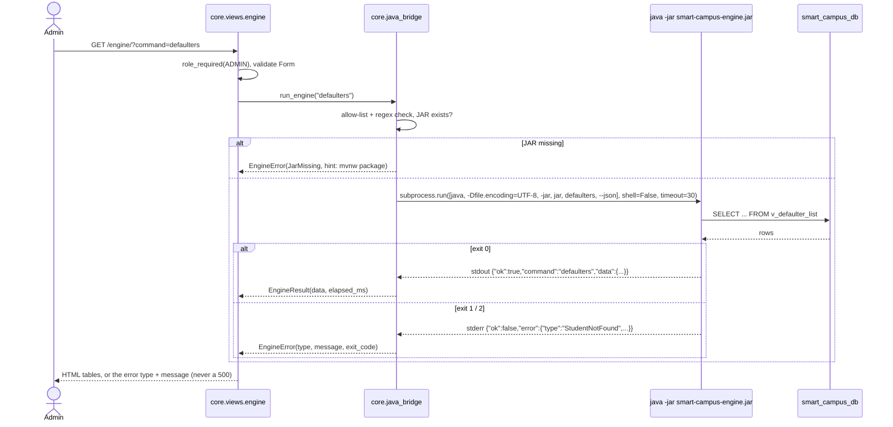

# Django Portal Design: `campus_portal`

This is the Django Lab design reference. It must match `campus_portal/*/urls.py`, `core/roles.py` and `core/java_bridge.py`.

## Architecture

Each component owns a different part of the database:
- **Django** owns only its own tables (`auth_*`, `django_*`, created by `migrate`).
- **`database/*.sql`** owns every domain table, view, trigger and procedure.
- **The Java engine** reads and writes the same domain tables over JDBC.

## URL map and role matrix

A user's role comes from the login (`core/roles.py`): a superuser is **Admin**, a `students.username` match is **Student**, and a `faculty.username` match is **Faculty**.

| URL | Purpose | Student | Faculty | Admin | Anonymous |
|---|---|:-:|:-:|:-:|:-:|
| `/` | Redirect to the role's dashboard | 302 | 302 | 302 | 302 → login |
| `/accounts/login/`, `/accounts/logout/` (POST) | Login / logout | ✓ | ✓ | ✓ | ✓ |
| `/student/` | Own profile, attendance, marks, CGPA, defaulter warning, timetable | **200** | 403 | 403 | 302 → login |
| `/faculty/` | Own courses and timetable | 403 | **200** | 403 | 302 → login |
| `/faculty/courses/<code>/` (`/attendance/`, `/marks/`) | Roster, attendance sheet, marks sheet. Another teacher's course returns 403. | 403 | **200** | 403 | 302 → login |
| `/admin-portal/` | Dashboard | 403 | 403 | **200** | 302 → login |
| `/accounts/password/` | Change own password | 200 | 200 | 200 | 302 → login |
| `/admin-portal/students/`, `faculty/`, `courses/` (+ `add/`, `<id>/edit/`, `<id>/delete/`) | Lists (search + pagination) and CRUD. Delete shows a confirm page; the POST deletes. | 403 | 403 | **200** | 302 → login |
| `/admin-portal/marks-audit/` | History from the AFTER UPDATE trigger | 403 | 403 | **200** | 302 → login |
| `/admin-portal/enrollments/` | List + enroll form | 403 | 403 | **200** | 302 → login |
| `/admin-portal/timetable/` | List + add form (clash check) | 403 | 403 | **200** | 302 → login |
| `/admin-portal/defaulters/`, `gpa-report/` | Reports; "declare" calls the procedure | 403 | 403 | **200** | 302 → login |
| `/engine/` | Java engine bridge | 403 | 403 | **200** | 302 → login |
| `/django-admin/` | Django's developer admin (superuser) | – | – | ✓ | login |

`core/tests/test_access.py` checks every cell of this table. `core/tests/test_polish.py` also walks the URL conf itself, so a page added later can't skip the role check unnoticed. A live check against the dev server returned the same codes.

## Where each rule runs

| Rule | Runs in | Django's part |
|---|---|---|
| Grade from marks | `trg_marks_before_insert/update` | Writes only internal/external marks, then shows what MySQL computed |
| Below 75% attendance | `v_defaulter_list` | Lists or highlights rows found in the view; never compares against 75 |
| Declared defaulters | `sp_refresh_defaulter_flags()` | The "Declare defaulter list" button runs `CALL` |
| Teacher double-booking | `trg_prevent_timetable_faculty_clash` | Shows the SIGNAL message with names instead of ids |
| Username unique across students and faculty | `trg_students_before_*`, `trg_faculty_before_*` | Shows the SIGNAL message on the form |
| Room/section double-booking, duplicates, ranges | UNIQUE / CHECK constraints | `core/db_errors.py` maps each constraint name to a sentence |
| Marks history | `trg_marks_after_update` → `marks_audit`, read via `v_marks_audit` | Admin "Marks audit" page and "Recent changes" on the faculty marks page |
| What a delete takes with it | FK `ON DELETE` (CASCADE / SET NULL / RESTRICT) | One `DELETE` via `services.delete_object`; RESTRICT becomes a friendly message |
| Enroll only in the student's current semester | **App-level**: `core/services.enroll_student` (and Java `StudentService.enroll`) | Raises `ServiceError` before the insert |

## Django → Java bridge

Each page makes at most one engine call, at about 0.7-1.1 s per call through the web server. Writes (`refresh-defaulters`, `enroll`) use POST + CSRF.
